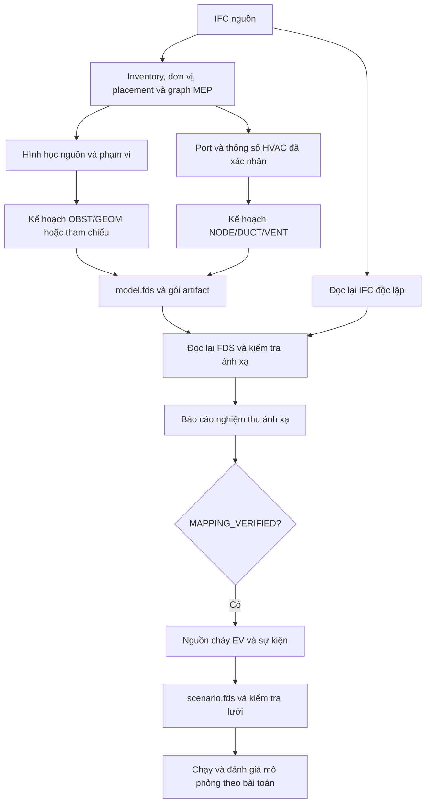

<a id="top"></a>

# IFCtoFDS — Chuyển đổi IFC sang FDS có kiểm định

**Từ mô hình BIM đến hình học FDS, mạng HVAC và tệp kịch bản cháy có thể truy xuất về nguồn IFC.**

[](https://github.com/fire-digital-twin-lab/IFCtoFDS/actions/workflows/verified.yml)
[](pyproject.toml)
[](LICENSE)

**Phiên bản mã nguồn:** 0.5.0 · **Cập nhật hướng dẫn:** 02/11/2026

[English README](README.en.md) · [Hướng dẫn HVAC chuyên sâu](docs/HVAC_NETWORK_IMPLEMENTATION.md) · [Changelog](CHANGELOG.md) · [Báo lỗi](https://github.com/fire-digital-twin-lab/IFCtoFDS/issues)

Bản tiếng Anh có thể chưa phản ánh đầy đủ các cập nhật HVAC/scenario trong hướng dẫn tiếng Việt này.


*Ảnh minh họa từ bản chụp ngày 17/10/2026; một số nhãn có thể khác giao diện hiện tại. Ảnh không phải bằng chứng mô hình đạt kiểm định. [Nguồn ảnh và mô hình](demo/readme/SOURCES.md).*

## Mục lục

1. [Giới thiệu và đối tượng sử dụng](#gioi-thieu)
2. [Khả năng và trạng thái hiện tại](#kha-nang)
3. [Quy trình tổng thể và thuật ngữ](#quy-trinh)
4. [Cài đặt và khởi động](#cai-dat)
5. [Chạy ví dụ đầu tiên](#vi-du-dau-tien)
6. [Sử dụng Workbench từng bước](#workbench)
7. [Nhiều IFC, phạm vi và tọa độ](#nhieu-ifc)
8. [Xuất mạng thông gió HVAC và kiểm tra trong PyroSim](#hvac)
9. [Sinh kịch bản cháy xe điện](#kich-ban-ev)
10. [Tệp đầu ra và cách đọc báo cáo](#ket-qua)
11. [Dùng dòng lệnh và tệp cấu hình](#cli)
12. [Tích hợp bằng API](#api)
13. [Kiến trúc và cấu trúc mã nguồn](#kien-truc)
14. [Kiểm thử và tái lập kết quả](#kiem-thu)
15. [Xử lý sự cố thường gặp](#su-co)
16. [Lộ trình, đóng góp, nguồn dữ liệu và trích dẫn](#dong-gop)

<a id="gioi-thieu"></a>

## 1. Giới thiệu và đối tượng sử dụng

IFCtoFDS hỗ trợ chuẩn bị đầu vào cho **Fire Dynamics Simulator — FDS** từ mô hình **Industry Foundation Classes — IFC**. Dự án gồm giao diện xem mô hình trên trình duyệt và backend Python chuyển đổi, lưu bằng chứng, đọc lại IFC/FDS để kiểm định ánh xạ.

Các đầu ra chính:

- Hình học công trình dưới dạng `&OBST` hoặc `&GEOM`.
- Danh mục phần tử, hệ thống MEP và quan hệ port từ IFC.
- Mạng `&HVAC` cho các đoạn ống thông gió đáp ứng điều kiện cấu hình.
- Gói manifest, hình học nguồn và báo cáo giúp truy nguyên kết quả.
- Tệp `scenario.fds` bổ sung nguồn cháy EV và sự kiện vào mô hình nền đã được xác minh.

Đối tượng sử dụng là người làm BIM, kỹ sư PCCC, sinh viên/người nghiên cứu và người phát triển công cụ BIM–CFD. Phần mềm giúp chuyển đổi và kiểm tra đầu vào; quyết định về nguồn cháy, vật liệu, thông gió, lưới và phương án thiết kế vẫn cần được thẩm định theo bài toán cụ thể.

**Cần phân biệt ba kết quả:** xuất được tệp, ánh xạ được xác minh và mô phỏng vật lý được xác minh. Hiện hệ thống có thể cấp `MAPPING_VERIFIED`; chưa tự động cấp `SIMULATION_VERIFIED`.

<a id="kha-nang"></a>

## 2. Khả năng và trạng thái hiện tại

| Chức năng | Hiện trạng | Điều kiện và giới hạn chính |
|---|---|---|
| Xem IFC/FDS, chọn phần tử, cây mô hình, lớp hiển thị | Đã hiện thực | Hình học hiển thị và hình học được kiểm định là hai luồng riêng |
| Inventory IFC | Đọc danh mục IfcProduct, đơn vị chiều dài, placement và metadata | Lệnh inventory thô chưa dựng hình học hoặc trích xuất graph MEP |
| Chuyển đổi Verified | IfcOpenShell, kiểm tra solid, chọn OBST/GEOM và truy nguyên nguồn | Nguồn không kín/không hợp lệ có thể bị từ chối; không tự vá bằng hộp bao |
| Lỗ mở và biên miền | Kiểm tra opening, boundary và thay đổi hình học | Một số trường hợp cần bằng chứng solver/effective geometry bổ sung |
| Nhiều IFC | Ghép nguồn, giữ định danh theo nguồn, áp transform và rebase | Cần xác nhận hệ tọa độ hoặc cung cấp transform cho từng nguồn |
| MEP | Đọc hệ thống, port và quan hệ nối tường minh | Có thể còn phần tử chưa phân loại hoặc chưa có kết nối |
| HVAC vận hành | NODE/DUCT và đầu VENT/AMBIENT từ port, thông số được khai báo | Chưa tự chuyển fan, damper, fitting, filter, aircoil; chưa ghép VENT với GEOM |
| Kịch bản EV | Preset, REAC/RAMP, nguồn cháy, thiết bị đo, sự kiện và batch | Sinh file và kiểm tra lưới; chưa phải bộ chạy batch CFD hoàn chỉnh |
| Miền nhiều mesh | Chia miền khi vượt ngưỡng cell mỗi mesh | Chia mesh không tự chứng minh hiệu quả MPI hoặc độ hội tụ nghiệm |
| Job và artifact | Hàng đợi, hủy, timeout, giám sát bộ nhớ, checkpoint, checksum | Tác vụ xử lý xong không đồng nghĩa mô hình đạt kiểm định |
| Kiểm tra FDS | Adapter chạy solver được ghim phiên bản, lưu bằng chứng | Effective geometry hiện giới hạn ở OBST trên một mesh |
| Đối chứng công trình | Workflow tạo/check reference và approval | Reference B1/B2 trong repo còn DRAFT; tạo candidate không phải phê duyệt |

**Mốc kiểm thử ngày 02/11/2026:** 471 bài Python qua trong bộ mặc định; 13 script JavaScript qua; 4 ca chạy với FDS 6.11.1 qua, gồm khởi tạo mạng HVAC có đầu AMBIENT và đầu VENT nối CFD. Các ca này không xác nhận lưu lượng/áp suất hút khói cho một công trình thực tế. Chưa thực hiện nhập trực tiếp bằng ứng dụng PyroSim trong đợt kiểm tra này.

<a id="quy-trinh"></a>

## 3. Quy trình tổng thể và thuật ngữ



Audit dựng lại mô hình từ IFC đã mở lại và phân tích FDS đã lưu, thay vì dùng mô hình tạm của exporter làm đối chứng. Hai luồng vẫn dùng chung thư viện hình học và chính sách/cấu hình; đây không phải kiểm chứng bằng hai bộ giải CAD độc lập.

| Thuật ngữ | Ý nghĩa trong dự án |
|---|---|
| BIM/IFC | Mô hình thông tin công trình và định dạng trao đổi đầu vào |
| FDS | Bộ giải mô phỏng cháy; `.fds` là tệp đầu vào |
| PyroSim | Phần mềm chuẩn bị/xem mô hình FDS; hình học và mạng HVAC là các loại đối tượng khác nhau |
| MEP | Các hệ cơ điện và đường ống, gồm thông gió, nước và chữa cháy |
| Port | Đầu nối của phần tử MEP; dùng để dựng quan hệ mạng |
| OBST / GEOM | Vật cản hình hộp / hình học tam giác trong file FDS |
| Inventory / manifest | Danh mục phần tử / bản kê quyết định và truy nguyên ánh xạ |
| Scope / simulation domain | Phạm vi phần tử được chọn / miền không gian CFD |
| Mesh | Lưới tính toán trong miền |
| Gate / finding | Một phép kiểm tra / một phát hiện cụ thể trong báo cáo |
| Artifact / bundle | Tệp kết quả / bộ tệp có liên hệ và kiểm tra toàn vẹn |

<a id="cai-dat"></a>

## 4. Cài đặt và khởi động

### 4.1. Chuẩn bị

| Thành phần | Vai trò |
|---|---|
| Git | Lấy mã nguồn; cũng có thể tải bản ZIP của repository |
| Python 64-bit, từ 3.10 | Backend; CI hiện kiểm tra Python 3.10–3.13 trên Windows và Ubuntu |
| Trình duyệt hỗ trợ WebGL | Giao diện xem mô hình |
| Node.js | Chỉ cần khi chạy kiểm thử/generator JavaScript; CI dùng Node 22 |
| FDS 6.11.1 | Tùy chọn khi cần bằng chứng từ solver |
| PyroSim/Smokeview | Tùy mục đích xem, chỉnh sửa hoặc đánh giá mô hình/kết quả |

RAM và thời gian xử lý phụ thuộc kích thước, độ phức tạp IFC và độ mịn lưới. Giới hạn worker mặc định là 4.096 MB, không phải cam kết mọi mô hình đều chạy được trong mức này.

### 4.2. Windows — PowerShell

```powershell
git clone https://github.com/fire-digital-twin-lab/IFCtoFDS.git
cd IFCtoFDS
python --version
python -m venv .venv
.\.venv\Scripts\Activate.ps1
python -m pip install -e .
python -m ifc_to_fds --help
```

Nếu máy nhận Python qua `py`, dùng `py -3 -m venv .venv` ở bước tạo môi trường.

Nếu `Activate.ps1` bị chặn, dùng trực tiếp Python trong môi trường riêng:

```powershell
.\.venv\Scripts\python.exe -m pip install -e .
.\.venv\Scripts\python.exe -m ifc_to_fds --help
```

Các lệnh `python` bên dưới giả định `.venv` đã được kích hoạt. Khi chưa kích hoạt, thay `python` bằng `.\.venv\Scripts\python.exe`.

### 4.3. Linux/macOS

```bash
git clone https://github.com/fire-digital-twin-lab/IFCtoFDS.git
cd IFCtoFDS
python3 -m venv .venv
source .venv/bin/activate
python -m pip install -e .
python -m ifc_to_fds --help
```

CI của repo kiểm tra Windows/Ubuntu. Trên macOS, việc cài dependency native phụ thuộc nền tảng và wheel có sẵn; môi trường này chưa được xác nhận bởi ma trận CI hiện tại.

### 4.4. Mở Workbench

```powershell
python -m ifc_to_fds serve --port 8000
```

Mở [http://127.0.0.1:8000](http://127.0.0.1:8000). Giữ cửa sổ server đang chạy khi sử dụng; kiểm tra backend ở [http://127.0.0.1:8000/api/health](http://127.0.0.1:8000/api/health). Dừng server bằng `Ctrl+C`.

Mở `index.html` qua `file://` chỉ phục vụ một số luồng trình duyệt/legacy. **Verified Mapping và các job backend cần server HTTP.**

### 4.5. Cấu hình FDS tùy chọn

Script sau tải và giải nén **bộ FDS Windows** được ghim checksum vào `.deps/`, không cài hệ thống:

```powershell
python scripts/install-fds.py
$fds = (Resolve-Path ".deps/fds-6.11.1/firemodels/FDS6/bin/fds_openmp.exe").Path
$env:IFCFDS_SOLVER = $fds
python -m ifc_to_fds serve --port 8000
```

Đặt biến trước khi khởi động server. Với CLI `convert`, truyền `--solver` như mục 11. Linux/macOS cần binary phù hợp hệ điều hành và đường dẫn tương ứng; script Windows không dùng cho các nền tảng đó. Xem [bản phát hành FDS 6.11.1](https://github.com/firemodels/fds/releases/tag/FDS-6.11.1) và [tài liệu FDS/Smokeview](https://pages.nist.gov/fds-smv/manuals.html).

<a id="vi-du-dau-tien"></a>

## 5. Chạy ví dụ đầu tiên

### 5.1. Ví dụ nhỏ, có kết quả dự kiến

[connected-ducts.ifc](docs/evidence/hvac-network-v1/connected-ducts.ifc) gồm một tường, hai đoạn ống thông gió, bốn port và một tầng `Review floor`. Đây là dữ liệu tổng hợp để kiểm tra luồng phần mềm.

Chạy từ thư mục gốc repository:

<!-- readme-example: first-convert -->
```powershell
python -m ifc_to_fds inventory docs/evidence/hvac-network-v1/connected-ducts.ifc
python -m ifc_to_fds convert docs/evidence/hvac-network-v1/connected-ducts.ifc -o scripts/out/readme-first/model.fds
```

Kết quả đã kiểm tra với mã nguồn hiện tại:

```text
connected-ducts.ifc: 8 IfcProduct entities
MAPPING_VERIFIED: scripts/out/readme-first/model.fds
```

Profile mặc định giữ hai ống làm **tham chiếu**, nên file này có tường nhưng chưa có mạng HVAC. Đây là kết quả đúng của lựa chọn mặc định. Mở:

- `scripts/out/readme-first/model.fds`: file hình học.
- `scripts/out/readme-first/model_acceptance_report.md`: báo cáo dễ đọc.
- `scripts/out/readme-first/model_inventory.json`: danh mục sau pipeline, đã có thông tin MEP/port.

Một số lượt chạy có warning từ thư viện. Đọc kết luận trong báo cáo và mã thoát CLI thay vì chỉ nhìn dòng warning.

### 5.2. Chạy trên Workbench

1. Khởi động server theo mục 4.4 và nạp `connected-ducts.ifc`.
2. Chờ preview, chọn profile `Mapping`.
3. Giữ toàn mô hình; chưa bật tùy chọn biên chuyên sâu.
4. Bấm `Run Verified Mapping`, chờ job kết thúc.
5. Mở bảng kiểm định, xác nhận `mapping_status` và tải báo cáo.
6. Thực hiện mục 8 để xuất hai ống thành mạng HVAC.

### 5.3. Mẫu công trình lớn hơn

| Tệp | Mục đích |
|---|---|
| `examples/AC20-FZK-Haus.ifc` | Xem tường, cửa, lỗ mở và lựa chọn tầng |
| `examples/AC20-Institute-Var-2.ifc` | Thử mô hình lớn hơn và phạm vi nhiều tầng |
| `examples/IfcOpenShell-Duplex.ifc` | Khảo sát nhiều loại phần tử kiến trúc |
| `docs/evidence/hvac-network-v1/connected-ducts.ifc` | Thử mạng HVAC nhỏ có quan hệ port rõ ràng |

Các IFC trong `examples/` không có graph hệ thống phù hợp làm ca nghiệm thu HVAC. Kết quả Verified phụ thuộc hình học nguồn và cấu hình; có thể `REJECTED` hoặc `INCONCLUSIVE`. Preview đẹp không chứng minh mô hình đã qua kiểm định. [Nguồn IFC mẫu](examples/SOURCES.md).

<a id="workbench"></a>

## 6. Sử dụng Workbench từng bước

### 6.1. Nạp và kiểm tra đầu vào

1. Chọn tệp `.ifc`; thêm nguồn tại `Additional Federated IFCs` nếu cần.
2. Kiểm tra tên nguồn, đơn vị chiều dài, số lượng phần tử và danh sách tầng.
3. Xem vị trí, hướng và tỷ lệ mô hình có đúng dự kiến không.
4. Chọn phần tử trong khung nhìn/cây mô hình, đọc metadata ở Inspector.

Preview có thể dùng web-ifc, backend preview hoặc luồng legacy tùy môi trường. Hình học xem nhanh có thể được giản lược; file Verified được dựng và kiểm tra theo backend Python.

### 6.2. Quan sát và lựa chọn

- Dùng điều khiển chuột và các góc camera để xem mô hình; chọn phần tử để đọc metadata.
- Dùng `Focus`, `Hide`, `Isolate` và khôi phục hiển thị để kiểm tra từng vùng.
- Bật/tắt lớp Structure, Doors/Windows, OBST, GEOM, `HVAC Network` để đối chiếu.
- Điều chỉnh opacity IFC/FDS để xem lớp phủ; section/clip giúp quan sát phía trong.
- Chế độ walk phục vụ quan sát. Ẩn phần tử trên viewer không thay thế quyết định scope/loại trừ trong pipeline.

### 6.3. Chọn phạm vi, miền và lưới

1. Chọn tầng/hộp phạm vi nếu chỉ xét một phần công trình.
2. Khai báo simulation domain khi cần miền CFD rõ ràng.
3. Đặt `Mesh resolution` theo mét, xem số cell ước tính.
4. Kiểm tra cấu kiện giao biên; chọn boundary policy khi phù hợp điều kiện hỗ trợ.

Chọn tầng không có nghĩa mọi cấu kiện qua ranh giới sẽ được cắt tự động. Phần tử biên có thể được giữ lại hoặc chờ kiểm định.

### 6.4. Chọn profile

| Giá trị | Nhãn giao diện | Dùng khi nào |
|---|---|---|
| `mapping` | Mapping | Chuyển đổi và kiểm định ánh xạ; cấu hình HVAC bằng reviewed decisions nếu cần |
| `geometry-fidelity` | Geometry Fidelity (Passive Equipment Shapes) | Giữ thêm hình học thiết bị MEP thành vật cản thụ động; hoạt động chưa tự được cấu hình |
| `research-basement` | Research Reference | Đối chiếu reference case có nguồn/hash/approval phù hợp |
| `simulation` | Simulation (Solver Evidence Required) | Yêu cầu mức mô phỏng; còn gate chưa hiện thực, chưa cấp SIMULATION_VERIFIED |

`Force detailed GEOM output` là tùy chọn chẩn đoán hình học, không biến thiết bị thành mạng vận hành.

### 6.5. Reviewed decisions và chạy Verified

Tải các JSON tương ứng tại `Reviewed Entity Decisions`, `Reviewed System Decisions` và `Approved Reference Deltas`. Quyết định riêng phần tử có thể ghi đè quyết định hệ thống.

Quyết định cần `action`, `policy_version`, `reviewer`, `rationale`, `evidence`. Đưa vật thể review thành `PASSIVE_OBSTACLE` còn cần các yếu tố đánh giá mức liên quan mô phỏng. Xem [chính sách mapping](ifc_to_fds/mapping/policy.py); `--include-review` đơn lẻ không thay thế hồ sơ quyết định.

Bấm `Run Verified Mapping`. Khi hoàn thành, đọc báo cáo theo mục 10 rồi tải kết quả. `Cancel` hủy xử lý, không phải thao tác xóa vĩnh viễn artifact.

### 6.6. Quick Preview/Quick Export

Luồng JavaScript phục vụ xem và xuất nhanh theo tập biểu diễn được hỗ trợ. Các tùy chọn voxel/hybrid/review solids khác chính sách Verified Python. File có hậu tố legacy/quick preview không mang kết luận MAPPING_VERIFIED chỉ vì xuất được.

<a id="nhieu-ifc"></a>

## 7. Nhiều IFC, phạm vi và tọa độ

### 7.1. Ghép nhiều nguồn

1. Nạp đúng các tệp/phiên bản kiến trúc, kết cấu, MEP.
2. Nếu đã xác nhận chung tọa độ, chọn `Sources share a confirmed coordinate system` hoặc `--common-coordinates`.
3. Nếu khác tọa độ, cung cấp vị trí/rotation qua giao diện hoặc ma trận transform.
4. Xem lớp phủ và placement trước khi chuyển đổi.

Backend không tự căn chỉnh bằng hộp bao hoặc GlobalId. Hai tệp cùng nội dung bị coi là nguồn trùng.

Cấu trúc transform minh họa, nguồn thứ hai tịnh tiến 10 m theo X:

```json
{
  "sources": {
    "common_coordinates": false,
    "transforms": {
      "0": [[1, 0, 0, 0], [0, 1, 0, 0], [0, 0, 1, 0], [0, 0, 0, 1]],
      "1": [[1, 0, 0, 10], [0, 1, 0, 0], [0, 0, 1, 0], [0, 0, 0, 1]]
    }
  }
}
```

Thay bằng transform được xác nhận của công trình. Khóa `0`, `1` theo thứ tự file đầu vào; cũng có thể dùng source ID. Ma trận theo hàng, 4×4; backend yêu cầu transform cứng, không reflection hoặc scale.

### 7.2. Scope khác với miền CFD

| Thiết lập | Ý nghĩa |
|---|---|
| `scope.storeys` | Chọn tầng theo tên hoặc storey ID |
| `scope.bounding_box` / `--bbox` | Lựa chọn không gian cần xét |
| `simulation_domain` / `--domain` | Miền đặt lưới CFD |
| `boundary_policy` | Xử lý phần tử giao biên miền |

Policy hiện có: `VALIDATED_BOUNDARY_OBST_SINGLE_MESH` cho OBST đủ điều kiện; `SOURCE_SOLID_DOMAIN_INTERSECTION` cho giao hình học nguồn với miền. Thiếu bằng chứng có thể giữ `PENDING_VALIDATION`.

### 7.3. Rebase và định danh

Với tọa độ lớn, pipeline có thể dời gốc để giảm vấn đề số khi xử lý/hiển thị. FDS lưu chú thích `IFC_COORDINATE_REBASE`; viewer khôi phục vị trí lớp phủ. Với hộp phạm vi/miền khai báo thủ công, nên chỉ rõ `coordinate_frame` và `simulation_domain_coordinate_frame` là `WORLD` hoặc `REBASED`.

| Định danh | Cách sử dụng |
|---|---|
| `GlobalId` | Mã IFC; có thể trùng giữa các nguồn được sao chép |
| `step_id` | Số STEP trong một file, ví dụ `28` |
| `source_id` | Hash nội dung file nguồn |
| `entity_key` | Khóa phần tử có nguồn: `source_id:step_id` |
| `port_key` | Khóa có nguồn của port |

Quyết định và mạng dùng khóa có nguồn. Sửa nội dung IFC làm đổi hash, nên cần tạo lại quyết định/port key tương ứng.

<a id="hvac"></a>

## 8. Xuất mạng thông gió HVAC và kiểm tra trong PyroSim

### 8.1. Chọn đúng loại biểu diễn

| Mục tiêu | Biểu diễn | Tác dụng |
|---|---|---|
| Giữ hình dạng để tham khảo | Gói hình học nguồn | Quan sát/truy nguyên, không tự tạo vật cản FDS |
| Mô hình hóa cản trở dòng khí bên ngoài | OBST/GEOM theo chính sách | Thiết bị là vật cản thụ động |
| Mô hình hóa vận chuyển khí trong ống | HVAC NODE/DUCT và đầu nối | Mạng vận hành 1D, cần topology và thông số |

Hình ống OBST/GEOM không tự trở thành mạng thông gió. Trong PyroSim, NODE nối các duct hoặc nối duct với miền/môi trường; xem [tài liệu NODE](https://www.thunderheadeng.com/docs/2026-1/pyrosim/hvac/nodes/).

### 8.2. Chạy bộ mẫu HVAC có sẵn

Giữ nguyên IFC và cấu hình đi kèm để source hash và port key khớp nhau:

<!-- readme-example: hvac-convert -->
```powershell
python -m ifc_to_fds convert docs/evidence/hvac-network-v1/connected-ducts.ifc --config docs/evidence/hvac-network-v1/configuration.json -o scripts/out/readme-hvac/model.fds
```

Kết quả dự kiến: `MAPPING_VERIFIED`, gate `hvac=PASS`, **3 NODE, 2 DUCT, một mạng nối liên tục**, cùng một OBST cho tường. Hai đầu AMBIENT dùng kiểm tra topology; ví dụ chưa phải hệ hút khói trao đổi khí với phòng CFD.

Trên Workbench:

1. Nạp cùng IFC mẫu, chọn `Mapping`.
2. Tải [decisions.json](docs/evidence/hvac-network-v1/decisions.json) vào `Reviewed Entity Decisions`.
3. Nếu dùng miền mẫu: X 0–10 m, Y 0–5 m, Z 0–5 m; cell size 0,2 m.
4. Chạy Verified và bật lớp `HVAC Network`.

### 8.3. Cấu hình mô hình của mình

Chạy Verified Mapping để lấy `model_inventory.json` có graph/port. **`inventory --json` chỉ đọc inventory thô; port rỗng ở đây chưa đủ kết luận IFC không có port.**

Khung quyết định cho một đoạn ống tròn:

```json
{
  "SOURCE_HASH:DUCT_STEP_ID": {
    "action": "HVAC",
    "policy_version": "hvac-v1",
    "reviewer": "Nguoi tham dinh",
    "rationale": "Xac nhan ong thong gio va dau noi",
    "evidence": "Ho so thiet ke thong gio",
    "hvac": {
      "diameter_m": 0.2,
      "roughness_m": 0.0001,
      "endpoints": {
        "SOURCE_HASH:EXTERIOR_PORT_STEP_ID": {
          "kind": "AMBIENT",
          "loss": [1.0, 1.0]
        }
      }
    }
  }
}
```

Thay khóa `SOURCE_HASH:…` bằng khóa thật; khung không chạy nguyên trạng với mô hình khác. Khai báo quyết định cho các đoạn tham gia mạng, nhưng chỉ đặt boundary tại đầu mạng. Port giữa các đoạn được gom theo quan hệ IFC tường minh; tọa độ trùng nhau đơn thuần không thay thế quan hệ nối.

| Tham số | Đơn vị/quy tắc |
|---|---|
| `diameter_m` | Đường kính tiết diện tròn, m, lớn hơn 0 |
| `area_m2`, `perimeter_m` | Diện tích và chu vi tiết diện khác; cần cả hai, không khai báo cùng diameter |
| `length_m` | Tùy chọn; mặc định khoảng cách hai port, không được ngắn hơn khoảng cách đó. Đường đi cong cần chiều dài xác nhận |
| `roughness_m` | Độ nhám tuyệt đối, m, không âm |
| `volume_flow_m3_s` | Lưu lượng áp đặt tùy chọn; dấu theo thứ tự hai port trong inventory, cần xác nhận hướng |
| `endpoints` | Bản đồ port key → loại đầu nối và thông số biên |

Tiết diện không còn suy ra từ AABB. Thông số dùng SI và được thẩm định; chưa tự trích/xác nhận đầy đủ thông số thủy lực từ IFC profile/property set.

### 8.4. Đầu nối CFD bằng VENT

Ví dụ đối tượng boundary cho một port:

```json
{
  "kind": "VENT",
  "vent_xb": [1, 1, 1, 1.4, 2, 2.3],
  "loss": [1, 1]
}
```

`vent_xb` theo thứ tự XMIN, XMAX, YMIN, YMAX, ZMIN, ZMAX trong tọa độ mô hình sau biến đổi. VENT phải có diện tích dương, trên mặt OBST được hỗ trợ hoặc mặt biên MESH, chứa port và trong miền. Backend tạo `SURF_ID='HVAC'` và NODE có `VENT_ID`. Nút nội bộ không khai báo AMBIENT/VENT; đầu mạng thiếu cấu hình bị chặn.

### 8.5. Đối chiếu trong PyroSim và giới hạn

Nhập `scripts/out/readme-hvac/model.fds` bằng chức năng nhập FDS của phiên bản PyroSim đang dùng. Kiểm tra danh sách/cây HVAC, số NODE/DUCT, nối mạng, đầu biên, chiều dòng và thông số; không chỉ nhìn hình ống. Ghi phiên bản PyroSim/FDS khi đối chiếu. Dự án đã kiểm tra FDS 6.11.1; chưa xác nhận thao tác nhập/lưu lại trực tiếp trong PyroSim ở đợt kiểm thử này.

Adapter hỗ trợ `IfcDuctSegment`/`IfcFlowSegment` được phân loại thông gió/hút khói, có hai port hợp lệ. Fan, damper, co/fitting, filter, aircoil và VENT ghép GEOM chưa được tự động chuyển. Ống nước chữa cháy không thành mạng khí chỉ vì có hình dạng ống. [Chi tiết và bằng chứng](docs/HVAC_NETWORK_IMPLEMENTATION.md).

<a id="kich-ban-ev"></a>

## 9. Sinh kịch bản cháy xe điện

### 9.1. Chuẩn bị nền và bố trí

- Tạo nền trên **cùng backend Workbench/API**, có bundle đã lưu và `MAPPING_VERIFIED`.
- Giữ đủ manifest, báo cáo và geometry package; backend kiểm tra hash khi nạp lại.
- Đặt xe hoàn toàn trong miền, với kích thước/cao độ phù hợp.
- Xác nhận tham số cháy, cửa và mục tiêu sử dụng kết quả theo bài toán.

Hash của FDS bất kỳ hoặc kết quả CLI ở ngoài job root không tự trở thành nền mà API tìm được. Backend không tạo phòng thay thế khi thiếu nền đã xác minh.

### 9.2. Thư viện preset

| Preset | Loại | Khoảng HRR đỉnh trong thư viện | Mức tin cậy ghi trong preset |
|---|---|---|---|
| `e-bike-lfp` | Xe hai bánh, LFP | 0,02–0,15 MW | low; giả định kỹ thuật, chưa có bộ calorimetry riêng trong thư viện |
| `auto-nmc` | Ô tô, NMC | 2–7 MW | medium; nguồn tham khảo/tóm tắt và giả định nằm trong bản ghi |

Đây là phạm vi tham số của [thư viện trong repo](reference-cases/ev-library/), không phải kết quả thử nghiệm cho mọi loại xe. Backend kiểm tra giá trị tùy chỉnh theo preset. `pack_kwh` không tự hiệu chỉnh toàn bộ HRR curve để cân bằng năng lượng pack.

### 9.3. Dùng bảng EV batch

1. Chạy Verified và xác nhận nền hợp lệ.
2. Mở bảng EV fire scenario.
3. Nhập `Vehicle Counts`, `Spacing`, `Chemistry Mix`, `State of Charge` và lựa chọn cửa.
4. Bấm `Generate EV Fire Batch` để tạo ma trận và đưa vào hàng đợi.
5. Xem từng job, mesh status và lỗi; tải artifact khi có kết quả.

Giao diện hiện dựng vị trí mẫu quanh gốc tọa độ, dùng SoC điều chỉnh HRR theo giả định đơn giản. Để bố trí theo công trình và đặt sự kiện cửa thật, dùng API mục 12.3. Trạng thái cửa của ma trận hiện tạo metadata `opening_events` với tên mẫu `OPENING_MAIN`; chưa tương đương gán `opening_states` vào entity cửa thật của backend.

Nhãn `Full Simulation` có thể còn xuất hiện trong bảng EV. Job này hiện **sinh file và kiểm tra lưới**, không chạy xong mô phỏng CFD.

### 9.4. Hiểu mesh gate và file kịch bản

Backend tạo phản ứng đơn/composite, RAMP, SURF, vật thể xe và VENT nguồn cháy. Mesh gate đọc lưới thực từ FDS đã ghép, đánh giá D*/Δx theo chính sách hiện tại:

| Tỷ số | Kết quả thông thường |
|---|---|
| D*/Δx < 4 | FAIL: lưới quá thô theo gate |
| 4 ≤ D*/Δx ≤ 16 | PASS |
| D*/Δx > 16 | INCONCLUSIVE: ngoài miền kiểm chứng của gate |

Tỷ số này không tự chứng minh hội tụ lưới hoặc tính đúng vật lý. `mesh_status=PASS` và `simulation_status=NOT_RUN` có thể cùng xuất hiện.

`scenario.fds` chứa nền và kịch bản; T_END được mở rộng theo RAMP/thời gian yêu cầu. `model.fds` nền được giữ riêng. Khai báo SPEC HF chưa phải nguồn HF định lượng; lan truyền thermal runaway giữa module pin và sprinkler chưa được tự động mô hình hóa đầy đủ.

Sự kiện cửa yêu cầu một fill OBST của IfcDoor/IfcWindow có thật trong manifest. Điều khiển gắn vào vật thể gốc, giữ ID/hình học/SURF. Cửa GEOM hoặc nhiều sự kiện trên cùng cửa chưa được hỗ trợ trong composer.

Sau khi sinh file, chạy và đánh giá mô phỏng bằng FDS phù hợp. Cần bổ sung đầu ra đo/quan sát và thiết lập vật lý theo mục tiêu nghiên cứu; dự án chưa tự cấp SIMULATION_VERIFIED cho bước này.

<a id="ket-qua"></a>

## 10. Tệp đầu ra và cách đọc báo cáo

### 10.1. Bộ tệp chuyển đổi

Với đầu ra `model.fds`, các tệp thường gồm:

| Tệp/thư mục | Nội dung |
|---|---|
| `model.fds` | Hình học, mạng HVAC đã yêu cầu, MESH và chú thích nguồn; nền mặc định T_END=0 |
| `model_manifest.json` / `.csv` | Quyết định, ánh xạ ID, provenance và hash |
| `model_acceptance_report.json` / `.md` | Gate, findings, metrics và kết luận |
| `model_inventory.json` | Metadata, phần tử, port, trạng thái sau pipeline |
| `model_mep_graph.json` | Hệ thống và kết nối MEP |
| `model_geometry.json` | Chỉ mục geometry package |
| `model_geometry.payloads/` | Payload nhị phân của mesh |
| `model_geometry.zip` | Archive vận chuyển geometry package |
| `model_configuration.json` | Cấu hình lượt chạy |
| `model_timings.json` | Thời gian các giai đoạn |
| `model_parity.json` | Trạng thái đối chiếu reference |
| `model_checksums.json` | Hash của artifact đã lưu |
| `scenario.fds`, `scenario.json` | Artifact riêng của job kịch bản |

Tiền tố theo tên file xuất CLI: `building.fds` đi cùng `building_manifest.json`, `building_acceptance_report.md`… Một số checkpoint nội bộ như `audit-state.json`, `mapping_plan.json` không có trong mọi bộ CLI cuối cùng.

Chuyển geometry package cần giữ chỉ mục cùng thư mục payload đúng tên, hoặc dùng ZIP. Copy riêng chỉ mục JSON sẽ thiếu mesh. Một NODE có thể truy nguyên về nhiều đoạn ống; manifest không phải ánh xạ 1–1 cho mọi record.

### 10.2. Ba cấp trạng thái

| Cấp | Ví dụ | Ý nghĩa |
|---|---|---|
| Job | QUEUED, RUNNING, COMPLETED, FAILED, CANCELLED, TIMED_OUT | Vòng đời tác vụ |
| Gate | PASS, FAIL, NOT_RUN, INCONCLUSIVE, NOT_APPLICABLE | Một phép kiểm tra |
| Acceptance | MAPPING_VERIFIED, REJECTED, INCONCLUSIVE | Kết luận theo mức/profile đang yêu cầu |

COMPLETED nghĩa là worker xử lý xong và có kết quả; report vẫn có thể REJECTED. NOT_APPLICABLE cần lý do hợp lệ. NOT_RUN và INCONCLUSIVE không phải PASS.

### 10.3. Đọc báo cáo theo thứ tự

1. Xem `status`, `mapping_status`, `simulation_status` và profile.
2. Xem gate bắt buộc, lý do và findings P0/P1.
3. Tra `element_id`/`entity_key` về inventory hoặc Inspector.
4. Đọc metrics/evidence trước khi đổi dung sai hoặc loại trừ phần tử.
5. Kiểm tra `output_complete` trong manifest/kết quả, giữ bộ artifact có checksum phù hợp.

Ví dụ rút gọn để đọc ý nghĩa, không phải schema đầy đủ:

```json
{
  "status": "MAPPING_VERIFIED",
  "mapping_status": "MAPPING_VERIFIED",
  "simulation_status": "INCONCLUSIVE",
  "gates": {
    "hvac": {"status": "PASS", "required": true},
    "solver": {"status": "INCONCLUSIVE", "required": false}
  }
}
```

Mapping có thể được xác minh khi solver/effective geometry chưa đủ bằng chứng vì các gate mô phỏng được xét riêng. Policy boundary cụ thể vẫn có thể cần solver để hoàn tất. Thiếu FDS không mặc nhiên chặn mọi lượt mapping.

### 10.4. Các nhóm gate

| Nhóm | Gate thường gặp |
|---|---|
| Cú pháp, nguồn và truy nguyên | syntax, source_inventory, traceability |
| Phạm vi, vị trí, miền | scope, placement, domain, boundary |
| Hình học, đầy đủ kết cấu và đường khí | geometry, geometry_preservation, structural_completeness, openings, air_path |
| Vai trò và hệ thống | representation, mep, hvac |
| Đối chứng | golden_reference_parity và gate/schema khi áp dụng |
| Solver/mô phỏng | solver, effective_geometry, mesh_resolution; physics, scenario, operational_model theo profile |

Tập gate thay đổi theo điều kiện; đọc báo cáo thực tế thay vì một tổng số cố định. Effective geometry hiện chỉ hỗ trợ OBST trên một mesh; GEOM/multi-mesh có thể còn chưa kết luận.

### 10.5. Kiểm tra checksum bằng PowerShell

<!-- readme-example: checksums -->
```powershell
$folder = "scripts/out/readme-hvac"
$checksums = Get-Content "$folder/model_checksums.json" -Raw | ConvertFrom-Json
foreach ($entry in $checksums.PSObject.Properties) {
    $actual = (Get-FileHash (Join-Path $folder $entry.Name) -Algorithm SHA256).Hash.ToLowerInvariant()
    [pscustomobject]@{ File = $entry.Name; Match = ($actual -eq $entry.Value) }
}
```

Match=True xác nhận các tệp trong danh sách khớp hash ghi nhận; không thay thế đọc report hoặc kiểm tra payload của geometry package.

<a id="cli"></a>

## 11. Dùng dòng lệnh và tệp cấu hình

### 11.1. Tra cứu và chuyển đổi

```powershell
python -m ifc_to_fds --help
python -m ifc_to_fds convert --help
python -m ifc_to_fds inventory docs/evidence/hvac-network-v1/connected-ducts.ifc --json
```

Lưu cấu hình cơ bản dưới đây thành `config.json` ở gốc repo:

```json
{
  "profile": "mapping",
  "cell_size": 0.2,
  "simulation_domain": {"xmin": 0, "xmax": 10, "ymin": 0, "ymax": 5, "zmin": 0, "zmax": 5}
}
```

```powershell
python -m ifc_to_fds convert docs/evidence/hvac-network-v1/connected-ducts.ifc --config config.json -o scripts/out/readme-config/model.fds
```

Ví dụ chọn tầng và miền mẫu rõ ràng:

<!-- readme-example: scoped-convert -->
```powershell
python -m ifc_to_fds convert docs/evidence/hvac-network-v1/connected-ducts.ifc --storey "Review floor" --domain 0 10 0 5 0 5 --cell-size 0.2 -o scripts/out/readme-scope/model.fds
```

Với hai file của công trình riêng, đã xác nhận tọa độ:

```powershell
python -m ifc_to_fds convert "kien-truc.ifc" "mep.ifc" --common-coordinates --config config.json -o scripts/out/cong-trinh/model.fds
```

Lệnh cuối cần thay file và miền thực tế. `--bbox` chọn phạm vi, `--domain` đặt miền CFD. `--decisions path.json` nạp quyết định phần tử; quyết định hệ thống dùng `system_decisions` trong config.

### 11.2. Kiểm định lại kết quả

<!-- readme-example: re-audit -->
```powershell
python -m ifc_to_fds audit docs/evidence/hvac-network-v1/connected-ducts.ifc --fds scripts/out/readme-hvac/model.fds --manifest scripts/out/readme-hvac/model_manifest.json --geometry-package scripts/out/readme-hvac/model_geometry.json -o scripts/out/readme-hvac/re-audit.json
```

Lệnh tạo `re-audit.json` và `.md`; mẫu đã chạy ra MAPPING_VERIFIED. Cần IFC gốc đúng nội dung; khi không cấp `--config`, audit lấy cấu hình trong manifest. Có thể dùng geometry ZIP thay chỉ mục.

### 11.3. Chạy cùng adapter FDS

Sau bước cài FDS Windows ở mục 4.5:

<!-- readme-example: solver-convert -->
```powershell
python -m ifc_to_fds convert docs/evidence/hvac-network-v1/connected-ducts.ifc --config docs/evidence/hvac-network-v1/configuration.json --solver "$fds" -o scripts/out/readme-solver/model.fds
```

Nền T_END=0 dùng kiểm tra khởi tạo solver. Đọc gate solver và log/evidence để biết binary, phiên bản và kết quả; không suy ra đã chạy một đám cháy hoàn chỉnh.

### 11.4. Mã thoát CLI và reference

| Mã | Ý nghĩa |
|---|---|
| 0 | Kết quả chấp nhận theo mức hiện tại, ví dụ MAPPING_VERIFIED |
| 1 | REJECTED |
| 2 | INCONCLUSIVE; hoặc candidate/reference chưa được phê duyệt theo lệnh |
| 3 | Lỗi chuyển đổi/audit/cấu hình hoặc trạng thái không xác định |

`reference-candidate`, `reference-check`, `reference-resolve` phục vụ gói đối chứng. Xem help từng lệnh và [golden mapping](docs/golden-mapping-parity.md). Candidate mới tạo vẫn là bản nháp, không tự APPROVED.

<a id="api"></a>

## 12. Tích hợp bằng API

Ví dụ PowerShell chạy trong **cửa sổ thứ hai**, tại gốc repo, khi server mục 4.4 đang chạy. Dùng `curl.exe` để tránh alias curl của Windows PowerShell. Backend mặc định: `http://127.0.0.1:8000`.

### 12.1. Nộp job và chờ kết quả

<!-- readme-example: api-submit -->
```powershell
$base = "http://127.0.0.1:8000"
$job = curl.exe --fail --silent --show-error -F "files=@docs/evidence/hvac-network-v1/connected-ducts.ifc" -F "configuration=<docs/evidence/hvac-network-v1/configuration.json" "$base/api/jobs" | ConvertFrom-Json
if ($LASTEXITCODE -ne 0) { throw "Khong nop duoc job" }
do {
    $state = Invoke-RestMethod "$base/api/jobs/$($job.id)"
    Write-Host $state.state
    if ($state.state -in @("QUEUED", "RUNNING")) { Start-Sleep -Seconds 1 }
} while ($state.state -in @("QUEUED", "RUNNING"))
if ($state.state -ne "COMPLETED") { throw "Job dung o trang thai $($state.state)" }
$result = Invoke-RestMethod "$base/api/jobs/$($job.id)/result"
$result | Select-Object status, mapping_status, simulation_status, output_complete
```

`files` là multipart file; `configuration` là JSON trong form. Cú pháp curl `configuration=<...` đọc nội dung file vào trường đó. Ví dụ dự kiến `mapping_status=MAPPING_VERIFIED`.

### 12.2. Đọc manifest và tải artifact

<!-- readme-example: api-artifacts -->
```powershell
New-Item -ItemType Directory -Force scripts/out/readme-api | Out-Null
$manifest = Invoke-RestMethod "$base/api/jobs/$($job.id)/artifacts/manifest"
Invoke-WebRequest "$base/api/jobs/$($job.id)/artifacts/fds" -OutFile scripts/out/readme-api/model.fds -UseBasicParsing
Invoke-WebRequest "$base/api/jobs/$($job.id)/artifacts/report" -OutFile scripts/out/readme-api/report.json -UseBasicParsing
Invoke-WebRequest "$base/api/jobs/$($job.id)/artifacts/geometry_archive" -OutFile scripts/out/readme-api/model_geometry.zip -UseBasicParsing
```

Khóa artifact trong URL gồm fds, manifest, report, markdown, inventory, mep, geometry_archive, checksums… Xem danh sách có thật ở trường `artifacts` của kết quả. Hash nền cho scenario lấy từ **manifest.bundle_sha256**, không phải hash riêng của model.fds.

### 12.3. Sinh EV từ nền vừa nộp

Một ô tô ở tâm `(5, 3, 0.75)` m, trong miền mẫu. Nền là job mục 12.1 trên cùng server:

<!-- readme-example: api-scenario -->
```powershell
$payload = @{
    bundle_sha256 = $manifest.bundle_sha256
    scenario_data = @{
        bundle_sha256 = $manifest.bundle_sha256
        ev_selections = @(
            @{ preset_id = "auto-nmc"; position = @(5.0, 3.0, 0.75); peak_hrr_mw = 4.5 }
        )
    }
}
$scenarioJob = Invoke-RestMethod -Method Post -Uri "$base/api/scenario-jobs" -ContentType "application/json" -Body ($payload | ConvertTo-Json -Depth 8)
do {
    $scenarioState = Invoke-RestMethod "$base/api/jobs/$($scenarioJob.id)"
    if ($scenarioState.state -in @("QUEUED", "RUNNING")) { Start-Sleep -Seconds 1 }
} while ($scenarioState.state -in @("QUEUED", "RUNNING"))
if ($scenarioState.state -ne "COMPLETED") { throw "Scenario dung o trang thai $($scenarioState.state)" }
$scenarioResult = Invoke-RestMethod "$base/api/jobs/$($scenarioJob.id)/result"
$scenarioResult | Select-Object status, mesh_status, simulation_status, peak_hrr_mw
Invoke-WebRequest "$base/api/jobs/$($scenarioJob.id)/artifacts/scenario_fds" -OutFile scripts/out/readme-api/scenario.fds -UseBasicParsing
```

Kết quả dự kiến: COMPLETED, `mesh_status=PASS`, `simulation_status=NOT_RUN`, công suất 4,5 MW. File cần được chạy/đánh giá tiếp theo mục tiêu mô phỏng.

Để thêm sự kiện cửa, đặt `opening_states` trong `scenario_data`. Khung JSON sau cần entity cửa/window OBST thật trong manifest; IFC hai ống không có cửa để chạy khung này:

```json
{
  "opening_states": [
    {"entity_key": "SOURCE_HASH:DOOR_STEP_ID", "state": "OPEN", "event_time_s": 30.0}
  ]
}
```

### 12.4. Endpoint và vận hành

| Method/URL | Chức năng |
|---|---|
| GET /api/health | Kiểm tra backend |
| POST /api/inventory | Metadata nguồn; nhận file hoặc files, đợi kết quả inventory |
| POST /api/jobs | Nộp chuyển đổi Verified |
| POST /api/preview-jobs | Nộp preview một nguồn |
| POST /api/scenario-jobs | Nộp scenario gắn bundle nền |
| GET /api/jobs/{id} | Theo dõi trạng thái |
| GET /api/jobs/{id}/result | Kết quả; offset/limit cho findings |
| GET /api/jobs/{id}/artifacts/{key} | Tải artifact khi job COMPLETED |
| GET /api/jobs/{id}/checkpoints/{key} | Tải bản chẩn đoán chưa được chấp nhận, có header trạng thái |
| GET /api/jobs/{id}/diagnostics | Thông tin lỗi nếu đã tạo |
| POST /api/jobs/{id}/cancel | Hủy xử lý |
| DELETE /api/jobs/{id}?purge=true | Xóa job/artifact theo thao tác purge tường minh |
| GET /api/reference-cases | Reference đã đăng ký |

Job lưu tại `.jobs/` mặc định. Mapping được xác minh được đánh dấu lưu bền vững; job không bền vững chịu chính sách retention. Tải bộ kết quả cần dùng lâu dài, đặc biệt là scenario.

| Biến môi trường | Mặc định/ý nghĩa |
|---|---|
| IFCFDS_JOB_ROOT | .jobs trong thư mục làm việc |
| IFCFDS_MAX_FILE_BYTES | 200 MiB mỗi IFC upload |
| IFCFDS_MAX_JOB_BYTES | 500 MiB tổng IFC/job; tối đa 16 nguồn upload |
| IFCFDS_MAX_WAITING | 2 job chờ |
| IFCFDS_TIMEOUT_S | 1.800 giây/job |
| IFCFDS_WORKER_MAX_MEMORY_MB | 4.096 MB |
| IFCFDS_JOB_RETENTION_S | 3.600 giây cho chính sách job không bền vững |
| IFCFDS_SOLVER | Đường dẫn solver cho backend |
| IFCFDS_API_KEY | Khóa truy cập khi cấu hình |
| IFCFDS_ALLOWED_HOSTS, IFCFDS_ALLOWED_ORIGINS | Cấu hình host/origin được phép |

HTTP 429 là hàng đợi đầy: chờ rồi nộp lại. HTTP 409 thường là kết quả chưa sẵn sàng hoặc trạng thái không cho phép. Giới hạn upload và RAM là hai giới hạn khác nhau.

### 12.5. API key

Server mặc định bind loopback. Bind ra địa chỉ khác loopback cần API key; có thể dùng `--api-key-file` và allowed hosts phù hợp. Khi bật key, thêm header vào `/api/*` trừ health:

```powershell
$headers = @{ "x-api-key" = $env:IFCFDS_API_KEY }
Invoke-RestMethod "$base/api/jobs/$($job.id)" -Headers $headers
```

Với curl, thêm `-H "x-api-key:..."`; tránh ghi khóa thật trong tài liệu hoặc repository.

<a id="kien-truc"></a>

## 13. Kiến trúc và cấu trúc mã nguồn

Dự án hướng tới modular monolith + ports/adapters và đang tách dần từ các luồng cũ. Cấu trúc hiện tại:

```text
ifc_to_fds/
├── domain/           # Model BIM, source, scope, mapping, MEP/HVAC, acceptance
├── application/      # Use case convert/audit/preview/save, xác minh nền scenario
├── adapters/         # Lưu artifact/reference, repository job và worker
├── bootstrap/        # Dependency/container
├── core/             # Inventory, units, placement, federation, facade tương thích
├── geometry/         # IFC kernel, mesh, boolean, package, cache, preview
├── mapping/          # Policy, scope/boundary, plan validation, exporter
├── mep/              # Classifier, graph, compiler mạng, adapter record HVAC
├── fire/             # EV library, emitter, composer, mesh gate facade
├── validation/       # Parser, engine/runner, checkers, metrics, solver, reference
├── pipeline.py       # Facade convert/audit/prepare/save
├── cli.py            # Giao diện dòng lệnh
└── server.py         # FastAPI
js/
├── ifc/              # Nạp IFC, backend/web-ifc preview
├── fds/              # Parser, geometry adapter, quick exporter
├── viewer/           # Scene, camera, picking, hiển thị
├── workbench/        # State, selection, visibility, navigation, bảng EV
├── ui/               # Giao diện và audit drawer
└── workers/          # Tác vụ nền trình duyệt và bundle inline được sinh
tests/                 # Unit, integration, mutation, baseline, solver, browser
reference-cases/       # Đối chứng công trình và thư viện EV
docs/                  # Hướng dẫn, ADR, audit, bằng chứng, kiến trúc mục tiêu
```

HVAC tách contract HvacNetworkPlan trong domain, compiler `mep/network.py`, adapter `mep/fds_records.py` và checker `validation/checkers/hvac.py`. Scenario tách xác minh nền và ghép điều khiển với vật thể gốc.

`validation/engine.py` và ValidationRunner vẫn cùng tồn tại, đã có checker HVAC/mesh gate nhưng chưa hợp nhất hoàn toàn. Ports/container cũng chưa thay thế hết import trực tiếp. [Kiến trúc mục tiêu](docs/architecture/02-target-architecture.md) là đích chuyển đổi, không phải tuyên bố mọi phần đã hoàn tất.

<a id="kiem-thu"></a>

## 14. Kiểm thử và tái lập kết quả

### 14.1. Python

```powershell
python -m pip install -e ".[test]"
python -m pip check
python -m pytest -q
```

Lệnh mặc định loại marker solver/browser. Mốc 02/11/2026: **471 passed, 9 deselected** trên Windows/Python 3.10.21. Đây là snapshot working tree sau sửa HVAC, không phải bảo đảm cho mọi revision/môi trường.

### 14.2. JavaScript

Danh sách đầy đủ trong [CI verified.yml](.github/workflows/verified.yml). Một số nhóm:

```powershell
node scripts/test-worker-bundle-parity.js
node scripts/test-hvac-viewer.js
node scripts/test-ev-scenario-panel.js
node scripts/test-workbench-stabilization.js
node scripts/test-artifact-downloads.js
```

Sau khi sửa dependency worker, sinh lại bundle tương ứng; không sửa trực tiếp `*-inline.js`:

```powershell
node scripts/generate-inline-parse-worker.js
node scripts/generate-inline-export-worker.js
```

### 14.3. Solver và browser

FDS Windows đã cài theo mục 4.5:

```powershell
$env:IFCFDS_SOLVER = (Resolve-Path ".deps/fds-6.11.1/firemodels/FDS6/bin/fds_openmp.exe").Path
python -m pytest -q -m solver
```

Mốc kiểm tra: **4 ca solver qua**, kiểm tra fixture/khởi tạo, không thay thế validation mô phỏng đích.

Để chạy browser suite, cài thêm Playwright theo phiên bản CI:

```powershell
python -m pip install playwright==1.58.0
python -m playwright install chromium
python -m pytest -q -m browser
```

Một số bài trên Windows chọn channel Microsoft Edge; cần Edge tương ứng hoặc điều chỉnh môi trường kiểm thử. Browser suite chưa chạy lại trong mốc kiểm chứng HVAC nêu trên.

### 14.4. Tái lập ví dụ mạng

```powershell
python scripts/audit-project-logic.py
```

Script tạo thư mục mới `scripts/out/logic-review-...`, in đường dẫn evidence.json, xuất ba profile để so sánh và ghi các trường hợp bị chặn. Mã thoát 0 nghĩa là thu thập xong quan sát; đọc kết quả để biết case nào được chấp nhận. [Bằng chứng sau sửa](docs/evidence/hvac-network-v1/evidence.json) và [audit gốc](docs/audit/LOGIC_ARCHITECTURE_REVIEW_2026-11-02.md).

<a id="su-co"></a>

## 15. Xử lý sự cố thường gặp

| Triệu chứng | Kiểm tra | Hướng xử lý |
|---|---|---|
| Activate.ps1 bị chặn | Chính sách PowerShell | Gọi trực tiếp .venv/Scripts/python.exe như mục 4.2 |
| Không thấy module ifc_to_fds | Python và thư mục làm việc | Cài -e . bằng đúng Python của dự án |
| Lỗi dependency native | Kiến trúc/phiên bản Python, wheel | Dùng môi trường 64-bit phù hợp CI; đọc lỗi dependency cụ thể |
| Mở giao diện nhưng Verified không chạy | file:// hay HTTP; /api/health | Chạy backend và mở loopback |
| Port 8000 bận | Server khác | Chọn serve --port 8001, đổi URL tương ứng |
| IFC ghép bị lệch | Đơn vị, tọa độ, transform/rebase | Xác nhận hệ tọa độ hoặc nhập transform; xem lớp phủ |
| Ống thành vật thể | Profile và decision | Geometry Fidelity là thụ động; cấu hình HVAC theo mục 8 |
| inventory --json thiếu port/mesh | Inventory thô hay sau pipeline | Xem inventory/MEP graph sau Verified |
| Unconfigured HVAC endpoint | Đầu mạng và phần bị cắt scope | Khai báo đầu biên thật, kiểm tra đoạn nối tiếp |
| HVAC requires ... | Loại IFC, phân loại, port, thông số | Bổ sung cấu hình; thiết bị chưa hỗ trợ cần adapter |
| VENT bị từ chối | Mặt, port, diện tích, miền | Chọn mặt OBST/MESH hợp lệ; GEOM coupling chưa hỗ trợ |
| Geometry/traceability FAIL | Findings và entity_key | Kiểm tra nguồn và bộ file; sửa theo bằng chứng |
| PENDING_VALIDATION | Phần tử biên và policy | Điều chỉnh miền hợp lý hoặc bổ sung bằng chứng biên |
| Thiếu solver/effective evidence | Binary, phiên bản, log, loại mesh | Cấu hình FDS đúng, đọc giới hạn adapter/profile |
| Không tìm được verified base | Hash, trạng thái nền, job root | Tạo nền cùng backend, lấy hash manifest, giữ đủ artifact |
| Xe ngoài miền/giao nhau | Tâm, kích thước, spacing | Điều chỉnh bố trí theo công trình, dùng API cho tọa độ rõ ràng |
| OPEN/CLOSED chưa gán cửa thật | Metadata và entity_key | Dùng opening_states theo mục 12.3 |
| Mesh gate FAIL/INCONCLUSIVE | D*/Δx từng nguồn, lưới thực | Điều chỉnh lưới/cấu hình và đánh giá lại bài toán |
| HTTP 401 / 429 / 409 | Key / hàng đợi / trạng thái job | Bổ sung header / chờ nộp lại / xem trạng thái |
| Timeout hoặc vượt RAM | Diagnostics, phần tử, cell, worker | Giới hạn phạm vi phù hợp, kiểm tra nguồn/tài nguyên |
| Thiếu geometry payload | Chỉ mục, .payloads, ZIP | Giữ đúng bộ hoặc dùng archive |

Khi báo lỗi, gửi phiên bản/commit, hệ điều hành, lệnh/thao tác, cấu hình, trạng thái job, diagnostics và findings liên quan. Dùng mô hình tối thiểu được phép chia sẻ; tránh đưa dữ liệu công trình riêng tư hoặc API key lên issue công khai.

<a id="dong-gop"></a>

## 16. Lộ trình, đóng góp, nguồn dữ liệu và trích dẫn

### 16.1. Hướng phát triển

- Adapter vận hành cho fitting, fan, damper và thành phần HVAC còn thiếu.
- Trích xuất/xác nhận profile, chiều dài đường đi và đơn vị MEP đầy đủ hơn.
- Đồng bộ giao diện EV với bố trí xe/sự kiện cửa thực tế của backend.
- Mở rộng effective geometry và ghép biên GEOM/multi-mesh.
- Hợp nhất điều phối validation, nối dependency qua ports, tiếp tục tách module.
- Hoàn thiện chạy/đánh giá mô phỏng, hội tụ lưới và các gate xét SIMULATION_VERIFIED.

### 16.2. Đóng góp và đọc thêm

Tạo issue với ca tái hiện và kết quả mong đợi. Sửa thuật toán cần kiểm thử hành vi/mutation phù hợp, mô tả thay đổi đầu ra/giới hạn và chạy CI liên quan. Phân biệt kiến trúc mục tiêu với implementation hiện có.

- [Hướng dẫn HVAC](docs/HVAC_NETWORK_IMPLEMENTATION.md).
- [Rà soát logic và kiến trúc ngày 02/11/2026](docs/audit/LOGIC_ARCHITECTURE_REVIEW_2026-11-02.md).
- [Kiến trúc và ADR](docs/architecture.md).
- [Workflow Verified](docs/verified-conversion.md).
- [Golden mapping/reference](docs/golden-mapping-parity.md).
- [Kế hoạch biên soạn README tiếng Việt](docs/README_VI_PLAN_2026-11-02.md).

Các báo cáo lịch sử phản ánh thời điểm ghi nhận; dùng trạng thái hiện tại và mã nguồn để biết tính năng đã được sửa sau đó.

### 16.3. Nguồn mô hình và ghi công

Phần mềm kế thừa [ProfRino/IFCtoFDS](https://github.com/ProfRino/IFCtoFDS) của Rino Lovreglio và các cộng tác viên. Nhánh nghiên cứu này được phát triển bởi Fire Digital Twin Lab, Trường Đại học Xây dựng Hà Nội (HUCE), theo metadata repository.

Nguồn KIT/IfcOpenShell và ảnh minh họa được ghi tại [examples/SOURCES.md](examples/SOURCES.md) và [demo/readme/SOURCES.md](demo/readme/SOURCES.md). Bộ HVAC trong docs/evidence/hvac-network-v1 là IFC tổng hợp để kiểm thử, không phải công trình được thẩm duyệt.

### 16.4. Trích dẫn và giấy phép

Xem [CITATION.cff](CITATION.cff) để lấy tác giả/repository; ghi thêm commit, cấu hình, phiên bản dependency và dữ liệu nguồn thực tế đã dùng để tái lập nghiên cứu.

Phần mềm có giấy phép **AGPL-3.0-or-later**. Xem toàn văn tại [LICENSE](LICENSE).

[↑ Về đầu trang](#top)
