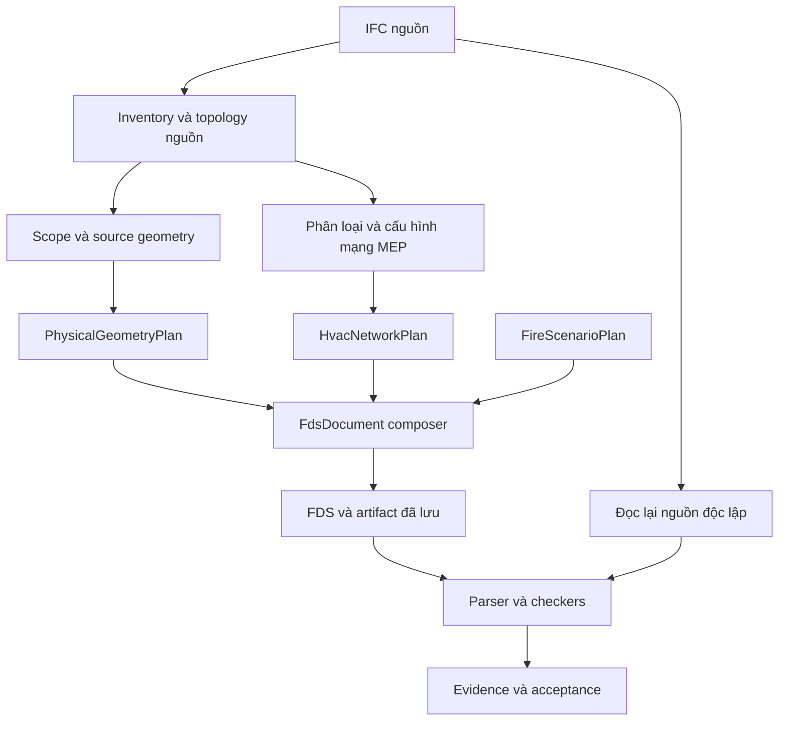

# Rà soát logic IFC → FDS, tương thích PyroSim và kiến trúc

Cập nhật sau rà soát: đã có bản sửa đầu tiên và kiểm tra FDS thật; xem [trạng thái hiện thực HVAC](../HVAC_NETWORK_IMPLEMENTATION.md). Phần bên dưới giữ nguyên bằng chứng trước sửa.

Ngày rà soát: **02/11/2026**. Mã nguồn: **v0.5.0, commit `16c1c9e`**.

## 1. Kết luận chính

**Dự án chưa hoàn thiện luồng chuyển mạng thông gió IFC thành mạng HVAC tương thích PyroSim/FDS.** Việc thấy ống dưới dạng vật thể là hệ quả của chính sách biểu diễn hiện tại. Nhánh `&HVAC` mới có bộ sinh bản ghi sơ bộ, chưa có bộ chuyển đổi mạng và kiểm định tương ứng.

Đã tái hiện bằng IFC4 có **hai đoạn `IfcDuctSegment`, bốn port và một quan hệ `IfcRelConnectsPorts`**, không chỉ kiểm tra chuỗi mã nguồn:

| Luồng | Vai trò của hai ống | Kết quả FDS | Kết quả audit hiện tại |
|---|---|---|---|
| Verified, profile `mapping` | `REFERENCE_GEOMETRY` | Không xuất hai ống thành vật cản hay HVAC; giữ trong gói tham chiếu | `MAPPING_VERIFIED` |
| Verified, profile `geometry-fidelity` | `PASSIVE_OBSTACLE` | Hai ống thành hai `&OBST`; không có HVAC | `MAPPING_VERIFIED` |
| Verified, quyết định `action=HVAC` | `HVAC` | Hai DUCT, bốn NODE, **hai mạng rời nhau** | `REJECTED` |
| Quick Export, mặc định | `review` | Loại hai ống khỏi hình học xuất | Không có audit Verified |
| Quick Export, bật review solids | Vật thể review được đưa vào hình học | Tổng ba vật thể gồm tường và hai ống; **0 HVAC** | Không có audit Verified |

`MAPPING_VERIFIED` của profile geometry-fidelity chỉ xác nhận ánh xạ theo chính sách hình học đã chọn. Nó không xác nhận rằng ống đã vận chuyển không khí, hút khói hoặc có quạt hoạt động.

### Phân biệt đúng với PyroSim

PyroSim có hai nhóm chức năng riêng: nhập/chuyển đổi hình học CAD/BIM và dựng mạng HVAC. Tài liệu nhập BIM không cho cơ sở để kết luận mọi hình ống nhập từ IFC sẽ tự trở thành mạng HVAC. Muốn PyroSim nhận một đối tượng là duct trong mạng, file FDS cần bản ghi và liên kết HVAC phù hợp. Xem [nhập hình học CAD/BIM](https://www.thunderheadeng.com/docs/2026-1/pyrosim/geometry/creating-geometry-cad/) và [mạng HVAC](https://www.thunderheadeng.com/docs/2026-1/pyrosim/hvac/).

Theo [tài liệu NODE của PyroSim](https://www.thunderheadeng.com/docs/2026-1/pyrosim/hvac/nodes/), nút nội bộ nối ít nhất hai duct; đầu nối ra môi trường hoặc miền CFD cần loại đầu nối tương ứng. [Tài liệu DUCT](https://www.thunderheadeng.com/docs/2026-1/pyrosim/hvac/ducts/) mô tả chiều dài theo đường nối nút, tiết diện tròn theo đường kính, và tiết diện khác theo diện tích/chu vi.

Do đó, đổi nhãn IFC, đổi màu sang STEEL hoặc đổi toàn bộ `OBST` thành `GEOM` **không giải quyết yêu cầu nhận dạng mạng thông gió**. Cũng không nên tự biến mọi `IfcPipeSegment` thành ống gió: ống nước chữa cháy và ống HVAC là những hệ vận hành khác nhau.

## 2. Phạm vi và bằng chứng

Đã lần theo các luồng CLI, HTTP, job worker, Quick Export, Verified Conversion, nạp IFC, federation, scope, geometry, MEP, mapping, serialization, manifest, audit, lưu artifact, viewer và sinh kịch bản EV.

Các kiểm tra đã chạy:

- `.venv/Scripts/python.exe -m pytest -q`: **451 passed, 7 deselected, 99 warnings**, thời gian 103,23 giây. Các bài có marker `solver` và `browser` được cấu hình loại khỏi lệnh mặc định.
- **12 script JavaScript trong CI** chạy thành công: worker parity, EV panel, golden workflow, artifact viewer, verified regressions, opening geometry, background worker, large opening, workbench stabilization, UI recovery, artifact downloads, legacy GEOM compatibility.
- Script bổ sung [audit-project-logic.py](../../scripts/audit-project-logic.py): tái hiện ba profile với IFC thật; kiểm tra Quick Export và parser/viewer; ống tròn đặt chéo; kiểm tra điều phối solver bằng hàm thăm dò; scenario thiếu mô hình nền; sự kiện mở cửa có fill gốc.
- Đọc inventory của cả ba IFC công khai trong `examples`: FZK Haus **127** sản phẩm, Institute **1.190**, Duplex **295**. Cả ba đều có **0 MEP system và 0 port connection** được trích xuất. Chúng không cung cấp ca nghiệm thu HVAC công trình thực tế.

Bằng chứng ổn định của lần rà soát nằm trong [thư mục evidence](../evidence/logic-review-2026-11-02/evidence.json), gồm IFC mẫu và các FDS tái hiện. Script audit tạo thư mục mới trong `scripts/out` mỗi lần chạy; mã thoát 0 có nghĩa là thu thập xong quan sát, **không có nghĩa mô hình đạt chuẩn**.

**Giới hạn:** chưa chạy nhập trực tiếp vào ứng dụng PyroSim, chưa nhận cặp IFC/FDS thực tế gặp lỗi của người dùng, chưa chạy FDS binary và browser suite trong môi trường này. Không phát hiện solver đã cấu hình hoặc Playwright trong `.venv`. Kết luận về quy tắc đầu nối được đối chiếu với mã nguồn FDS 6.11.1, đúng phiên bản repo đang ghim; chưa xác nhận phiên bản PyroSim người dùng đang cài.

## 3. Phát hiện cần xử lý

### R01 — P1: Hai mục tiêu hình học và thông gió đang bị gộp vào một lựa chọn biểu diễn

**Vị trí:** `ifc_to_fds/mapping/policy.py:202–230,270–273`; `js/fds/fds-exporter.js:473–479`.

Với `geometry_fidelity=True`, MEP chuyển sang `PASSIVE_OBSTACLE`. Với profile mapping thông thường, MEP giữ vai trò tham chiếu. Chỉ quyết định HVAC riêng mới đi vào nhánh xuất HVAC; giao diện chưa có trình cấu hình mạng tương ứng, chủ yếu nhận quyết định qua JSON.

Đây là hành vi có chủ đích của profile, nhưng chưa đáp ứng yêu cầu “ống thông gió nhập vào PyroSim được nhận là mạng thông gió”. Không thể suy ra lỗi nằm ở PyroSim khi đầu vào FDS chỉ chứa các bản ghi hình học.

**Hướng xử lý:** tách ít nhất ba quyết định: hiển thị hình học nguồn, vật cản tác động CFD bên ngoài, và mạng vận chuyển khí 1D. Một ống có thể cần cả hình học vỏ ngoài và mạng vận hành, với chính sách rõ ràng về phần nào tham gia CFD.

### R02 — P1: Nhánh xuất HVAC sinh đầu nối không hợp lệ với FDS

**Vị trí:** `ifc_to_fds/mapping/exporter.py:391–399`.

Mỗi NODE được sinh chỉ nối một DUCT, có XYZ nhưng không có `VENT_ID`, `AMBIENT` hay kết nối GEOM. Cả bốn nút trong IFC mẫu đều có lỗi điều kiện đầu nối này.

Đối chiếu [mã HVAC của FDS 6.11.1](https://github.com/firemodels/fds/blob/FDS-6.11.1/Source/hvac.f90), kiểm tra `ERROR(569)` từ chối nút một duct thiếu loại đầu nối, và `ERROR(547)` yêu cầu nút nội bộ có ít nhất hai duct. Đây là đối chiếu quy tắc nguồn, chưa phải log của một lần chạy solver.

**Hướng xử lý:** tạo NODE từ topology và loại biên đã được xác nhận. Không tự gán mọi đầu hở thành AMBIENT: thao tác đó có thể làm thay đổi đường đi khí của mô hình. Đầu nối CFD phải có liên kết tương thích; phần giao với GEOM cần nhánh hỗ trợ và kiểm chứng riêng.

### R03 — P1: Quan hệ nối ống có trong IFC nhưng bị bỏ qua khi xuất

**Vị trí:** `ifc_to_fds/mapping/exporter.py:359–365`; so với dữ liệu do `ifc_to_fds/mep/mep_graph.py` trích xuất.

Exporter tạo `NODE_<counter>_A/B` riêng theo từng phần tử, không dùng `model.mep_graph.connections` hoặc port để tạo nút chung. Trong ca hai ống nối nhau, hai NODE ở cùng tọa độ vẫn có hai ID khác nhau. Kết quả là hai thành phần mạng rời, mặc dù nguồn có một quan hệ nối thật.

Fitting, tee, terminal, fan và damper cũng chưa được biên dịch thành các thành phần vận hành phù hợp trong nhánh này; một quyết định HVAC không mang thông số quạt hoặc kiểu đầu nối.

**Hướng xử lý:** xây dựng `HvacNetworkPlan` trước serializer; gom các port có quan hệ nối xác nhận vào nút mạng chung, chuyển fitting thành junction/loss, giữ truy nguyên nhiều phần tử IFC về một thành phần mạng khi cần.

### R04 — P1: Tính chiều dài và tiết diện ống từ AABB làm sai thông số thủy lực

**Vị trí:** `ifc_to_fds/mapping/exporter.py:367–386`.

Đoạn mã chọn chiều dài theo kích thước lớn nhất của hộp bao, rồi nhân hai kích thước còn lại thành diện tích. Cách này chỉ tình cờ đúng với một số khối hộp thẳng theo trục; không phù hợp ống tròn, ống chéo, co và đoạn thay đổi tiết diện.

Tái hiện bằng ống tròn dài **3 m**, bán kính **0,1 m**, trục nghiêng 45° trong mặt phẳng XY:

| Đại lượng | Giá trị hình học đã biết | File xuất |
|---|---:|---:|
| Chiều dài | 3 m | 2,2627 m |
| Diện tích tiết diện | 0,0314159 m² | 0,4525 m² |
| Tỷ số diện tích xuất/thật | 1 | **14,4035** |

**Hướng xử lý:** lấy chiều dài theo centerline/port và profile cục bộ; dùng diameter hoặc area/perimeter được chuẩn hóa đơn vị. Thông số thiếu hoặc suy luận không chắc chắn phải có trạng thái cần bổ sung, không tự cấp `CONFIGURED` chỉ vì chọn action HVAC.

### R05 — P1: Manifest và audit chưa biết cách xử lý thành phần HVAC

**Vị trí:** `mapping/policy.py:270–273`; `mapping/exporter.py:365`; `validation/parser.py:54–56`; `validation/engine.py:235–240`; `application/use_cases/audit_conversion.py:189–190`.

Nhánh HVAC thêm NODE/DUCT vào `fds_primitive_ids`, nhưng `ParsedFDS.primitives` chỉ có OBST/GEOM/HOLE/VENT. Audit so hai tập ID này và báo sai khác; tiếp đó vẫn đòi solid cho phần tử có strategy HVAC. Ca kiểm tra end-to-end thực tế trả về:

- `Manifest primitive set differs from serialized FDS`;
- `Missing required FDS solid` cho cả hai duct.

Cùng lúc, phần tử ghi `simulation_role=HVAC`, `operational_status=CONFIGURED` nhưng `fds_representation=NONE`; coverage lại gán cứng `operational_configured=0`. Những trường này không tạo thành hợp đồng trạng thái nhất quán.

**Hướng xử lý:** phân biệt định danh hình học và định danh vận hành, thêm collection HVAC và validator riêng; geometry gate không đòi solid thay cho mạng. Audit cần kiểm tra sự tồn tại, topology, tham số và truy nguyên của các HVAC record từ file đã lưu.

### R06 — P1: Parser hiện tại chưa đủ làm cổng hợp lệ cho HVAC

**Vị trí:** `ifc_to_fds/validation/parser.py:143–171,265–273`.

Ba phép thử cho kết quả:

| Trường hợp | Quan sát |
|---|---|
| NODE khai báo `AMBIENT=.TRUE.` | Bị đánh dấu `HVAC.AMBIENT` chưa hỗ trợ |
| NODE và DUCT cùng dùng ID `SUPPLY 1` ở hai loại thành phần | Báo `Duplicate ID SUPPLY 1` |
| DUCT tham chiếu hai NODE không tồn tại, `AREA=0`, `LENGTH=-1` | Không có parse error hoặc unsupported |

Việc dùng cùng tên ở namespace NODE và DUCT xuất hiện trong [ca kiểm chứng HVAC chính thức của FDS](https://github.com/firemodels/fds/blob/FDS-6.11.1/Verification/HVAC/HVAC_damper.fds). Parser hiện gom chúng vào namespace HVAC duy nhất.

Parser được thiết kế cho một tập con FDS; vấn đề là nhánh HVAC mới đang dùng kết quả của tập con này để chứng minh file xuất hợp lệ, trong khi chưa có validator ngữ nghĩa mạng bù lại.

**Hướng xử lý:** tách đọc cú pháp và kiểm tra ngữ nghĩa; namespace ID theo loại thực thể; kiểm tra tham chiếu, số đầu nối, tham số dương, hướng dòng và điều kiện biên. Thêm các trường FDS được hỗ trợ theo phiên bản có kiểm chứng.

### R07 — P1: Luồng audit đang dùng chưa đi qua cổng mesh-resolution của runner mới

**Vị trí:** `application/use_cases/audit_conversion.py:19,59`; `validation/engine.py:660–673`; `validation/runner.py`; `validation/checkers/solver.py:40–61`.

Luồng chính vẫn gọi `run_independent_validation` trong `engine.py`, còn `ValidationRunner` có bộ checker riêng. Engine gọi solver khi syntax PASS, không chạy cổng `mesh_resolution` mới.

Với cùng file có đám cháy khoảng 4,5 MW và ô lưới cỡ 2 m, thăm dò điều phối cho kết quả:

- Engine: **gọi adapter solver một lần**, không có gate mesh-resolution.
- Runner: `mesh_resolution=FAIL`, `D*/dx≈0,875`, **không gọi solver**.

Không có solver thật được gọi trong phép thử này. Ngoài ra, `SolverChecker` nhận `effective_gate` nhưng không đưa kết quả đó vào báo cáo runner. Bộ parity test hiện so một tập gate và chưa khóa được các khác biệt này.

**Hướng xử lý:** một bộ điều phối checker duy nhất cho CLI/API/worker. Trước khi thay engine, phải chuyển đủ source preflight, hiệu dụng hình học, coverage, source reread và policy nghiệm thu; tránh thay trực tiếp bằng runner rồi mất các bảo vệ đang có.

### R08 — P1: Backend sinh scenario chấp nhận hash không gắn với mô hình đã kiểm chứng

**Vị trí:** `server.py:285–298`; `adapters/jobs/runner.py:106–158`.

Worker tìm mô hình nền theo hash trong các thư mục anh em, nhưng không buộc phải tìm được bộ artifact đã được chấp nhận. Nếu không có nền, nó tự tạo phòng 10×10×4 m, rồi gọi emitter với `verification_status='MAPPING_VERIFIED'` gán cứng.

Tái hiện với hash `aaaa…aaaa`, một xe `auto-nmc`, không có base model: worker thoát 0, tạo `scenario.fds`, trả `COMPLETED`, `mesh_status=PASS`. PASS ở đây là kết quả kiểm tra kích thước lưới, **không phải kết quả mô phỏng hay bằng chứng mô hình nền đã được xác minh**.

**Hướng xử lý:** yêu cầu `base_job_id`/artifact reference tồn tại, kiểm tra acceptance và hash của file/manifest/geometry/plan; lấy lưới từ FDS nền thật. Chế độ phòng mẫu, nếu giữ, phải là một chế độ demo được chọn rõ ràng. Sinh kịch bản và chạy mô phỏng cần hai use case/trạng thái riêng.

### R09 — P1: Sự kiện mở cửa không loại bỏ fill cố định đã có trong FDS nền

**Vị trí:** `ifc_to_fds/fire/scenario_emitter.py:431–487`.

Emitter thêm một OBST có CTRL_ID tại vị trí cửa nhưng không thay hoặc điều khiển OBST/GEOM gốc. Với nền đã chứa một cửa đóng, ca tái hiện có **hai OBST cùng tọa độ**, trong đó `OBST_1_Closed_door` không có CTRL_ID. Dù vật thể được thêm đổi trạng thái thế nào, vật thể cố định gốc vẫn tồn tại.

**Hướng xử lý:** scenario composer phải điều khiển biểu diễn fill gốc hoặc biên dịch lại phần closure theo event; không chồng thêm một vật thể độc lập và cho rằng cửa gốc sẽ mở. Cần kiểm thử đường đi khí trước/sau thời điểm sự kiện, bao gồm cả base fill dạng GEOM.

## 4. Tình trạng các tính năng chủ chốt

| Nhóm | Đánh giá hiện tại | Giới hạn hoặc phần cần làm tiếp |
|---|---|---|
| Inventory IFC, GlobalId/STEP/source identity | Có nền tảng và test tốt; giữ inventory theo IfcProduct | Nạp đủ metadata không đồng nghĩa đã có đủ dữ liệu vận hành MEP |
| Đơn vị, placement, federation | Có kiểm tra đơn vị chiều dài, tọa độ, nguồn trùng, transform cứng và provenance | Chưa có hợp đồng đầy đủ cho lưu lượng, áp suất và thông số HVAC đa đơn vị |
| Geometry OBST/GEOM, opening, boundary | Có kiểm tra solid, lỗ mở, thay đổi hình học và nguồn độc lập; không tự vá mesh lỗi bằng bbox trong nhân geometry | FDS-effective cho GEOM/multi-mesh còn giới hạn; nguồn không kín có thể bị từ chối |
| Scope theo tầng/hộp bao | Có mô hình phạm vi và kiểm thử boundary/placement | Hiện trích xuất geometry trước khi áp scope; chọn ít tầng chưa chắc giảm nhiều chi phí kernel |
| MEP inventory và graph | Đọc system, port, quan hệ kết nối thực, coverage và trạng thái chưa phân loại | Chưa chuyển graph thành mạng CFD hoạt động; R02–R06 |
| Mapping/manifest/artifact | Có hash, reverse mapping, package nhị phân, checkpoint và lưu kết quả | Hợp đồng primitive còn tập trung vào solid; chưa nhất quán HVAC |
| Multi-mesh | Có chia miền theo số cell và bài kiểm tra | Chưa phải bằng chứng chạy MPI, cân bằng tải hay hội tụ nghiệm; effective geometry còn giới hạn |
| Independent audit và acceptance | Có nhiều gate, source reread, phân biệt mapping/simulation | Hai engine lệch nhau; `SIMULATION_VERIFIED` cố ý chưa được cấp tự động |
| EV library và scenario emitter | Có REAC, RAMP, nguồn cháy, sensor/control, batch UI và gate D*/dx | R07–R09; khai báo SPEC HF chưa tạo nguồn phát HF định lượng; energy balance hiện là phép tính/ghi nhận, không tự hiệu chỉnh đường HRR theo pack |
| Job service và storage | Test pass cho SQLite, restart, cancel/timeout, giới hạn bộ nhớ, artifact/checkpoint | Scenario worker hiện sinh file và kiểm tra mesh, không phải bộ chạy batch CFD hoàn chỉnh |
| Viewer/workbench | Các kiểm tra JS về selection, source identity, visibility, recovery và artifact tải nền đều pass | Parser JS giữ HVAC trong rawRecords nhưng không có collection/rendering mạng; chưa chạy lại browser suite thật |
| Golden/reference công trình | Có cơ chế kiểm tra hash, parity và quyết định phê duyệt | `reference-cases/basement-b1-b2/approval.json` vẫn `DRAFT`; chưa thể coi case này là đối chứng công trình đã phê duyệt |

Các SURF có tên CONCRETE/STEEL/WOOD hiện chủ yếu gán màu. Không nên diễn giải tên SURF đó thành việc đã mô hình hóa tính dẫn nhiệt, nhiệt dung, phản ứng nhiệt phân của vật liệu.

## 5. Đánh giá kiến trúc đang có

Hướng **modular monolith + ports/adapters** trong các ADR hiện có là phù hợp. Không cần viết lại toàn bộ hoặc chuyển thành microservices để sửa các vấn đề trên. Phần còn thiếu là ranh giới chức năng thực và một đường thực thi nhất quán.

Các điểm tốt nên giữ: mô hình dữ liệu domain tách khỏi framework/kernel; MappingPlan có bước kiểm tra quyền biểu diễn; adapter artifact đã được tách; geometry nguồn và preview có mức tessellation/cache khác nhau; audit đọc lại nguồn và giải phóng mô hình converter trước khi dựng mô hình đối chiếu.

Các điểm cần sửa:

1. **Ports chưa được dùng tại những khâu chính.** `IfcReaderPort`/`FdsExporterPort` mới xuất hiện trong phần khai báo/re-export. Use case vẫn import trực tiếp federation, geometry, exporter và engine. Chữ ký exporter port cũng chưa khớp API serializer hiện tại. Container chưa thực sự lắp các dependency này vào use case.
2. **Hai bộ validation có hành vi khác nhau**, đã tạo lỗi chức năng R07. Tách file checker không đủ nếu đường chạy chính vẫn đi qua implementation cũ.
3. **Một CanonicalElement chứa nhiều trạng thái của nhiều giai đoạn.** Chính sách, scope, source geometry, operational status, emitted IDs và kết quả audit nằm cùng model. Nhiều trạng thái là chuỗi tự do; `SimulationRole` enum chưa chứa HVAC dù policy dùng giá trị này.
4. **MappingStrategy đơn trị không biểu đạt được cả hình học và vận hành.** DUCT/FAN/NODE/VENT cần network plan riêng, không phải thêm từng nhánh if vào solid exporter.
5. **Frontend còn tập trung trách nhiệm.** Không tính thư viện vendor: viewer **2.104 dòng**, IFC adapter **2.048**, app-controller **1.803**, FDS exporter **1.416**. Bốn file tổng **7.371 dòng**; tách thư mục workbench chưa tách hết trách nhiệm của các file này.
6. **Ba đường diễn giải dễ gây lệch kỳ vọng:** viewer nguồn, Quick Export JS và Verified Python. Cần chia sẻ hợp đồng trạng thái/định danh, và ghi rõ năng lực từng đường. Quick Export không nên tạo cảm giác đã có mạng HVAC.
7. **Kiểm thử mới về HVAC chủ yếu kiểm tra có chuỗi `&HVAC` và parser không báo lỗi.** Chưa khóa topology, điều kiện đầu nối, số liệu tiết diện và nghiệm thu end-to-end; do đó toàn bộ suite xanh vẫn đi cùng R02–R06.

## 6. Kiến trúc đề xuất: module theo chức năng, layer bên trong module

Áp dụng cách tổ chức anh đề xuất: **tách module trước, mỗi module tách layer theo nhu cầu**. Không cần tạo đủ bốn lớp cho những module chỉ có vài hàm thuần.

```text
ifc_to_fds/
  modules/
    source/        # IFC inventory, units, placements, federation
    geometry/      # source solids, openings, scope intersection
    mep/           # semantic network -> operational HVAC plan
    fire/          # EV presets, HRR, events, devices, scenario plan
    fds/           # typed FDS document, parser, serializer, version support
    validation/    # checker orchestration, evidence, acceptance policy
    artifacts/     # sealed bundle, manifest, package, reference repository
    execution/     # job lifecycle, queue, solver process, cancellation
  contracts/       # small shared identity/unit/bounds/evidence contracts
  interfaces/      # CLI, HTTP
  bootstrap/       # concrete dependency composition
```

Ví dụ module cần nhiều lớp nhất:

```text
mep/
  domain/          # MepNetwork, HvacNode, DuctSpec, TerminalSpec, policies
  application/     # BuildHvacNetwork, ConfigureSystem, ValidateNetwork
  ports/           # read source topology, resolve geometry/parameters
  adapters/        # IfcOpenShell network/parameter reader
```

Serializer cụ thể của FDS thuộc module `fds`; module `mep` trả về network plan đã định kiểu. Không để MEP domain phụ thuộc FastAPI, filesystem hoặc chuỗi namelist.

Luồng chính đề xuất:



Những hợp đồng nên có trước khi di chuyển nhiều file:

- `SourceSnapshot`: nhận dạng/quan hệ nguồn, bất biến qua các giai đoạn.
- `PhysicalGeometryPlan`: phần nào thành OBST/GEOM, phần nào chỉ là tham chiếu.
- `HvacNetworkPlan`: NODE, DUCT, fan, damper, terminal, area/diameter/perimeter/length và provenance tham số.
- `FireScenarioPlan`: nguồn cháy và sự kiện gắn vào đúng biểu diễn nền.
- `FdsDocument`: kiểu dữ liệu riêng cho geometry và operational records, namespace và tham chiếu rõ ràng.
- `ArtifactBundle`/`EvidenceSet`: kết quả đã lưu và bằng chứng độc lập; không dùng cờ do client gửi thay cho kiểm tra artifact.

Có thể tiếp tục dùng Pydantic. Điều cần thiết là ownership và trạng thái đúng, không phải đổi toàn bộ domain sang dataclass. Giữ facade tương thích trong quá trình chuyển để CLI/API không bị thay đổi đồng loạt.

## 7. Các hướng tối ưu có giá trị

1. **Trích xuất theo hai pha:** inventory/topology trước, xác định scope và tập phần tử biên cần thiết, rồi mới chạy geometry kernel cho phần cần dùng. Vẫn giữ inventory đầy đủ và đủ ngữ cảnh boundary/opening để audit không bỏ sót phần giao miền.
2. **Dùng biểu diễn phân tích của ống:** centerline + profile + port tốt hơn suy luận thủy lực từ hàng nghìn tam giác. BREP/mesh phục vụ hình học và đối chiếu; phép suy luận thiếu dữ liệu phải có evidence và trạng thái cần thẩm định.
3. **Tách ngân sách preview và export:** repo đã có preview deflection 5 mm, authoritative geometry 0,1 mm và cache khóa theo source/settings. Nên giữ nền này, đo riêng chi phí IFC kernel, topology, package và audit trước khi tối ưu tiếp; không tăng tốc bằng cách dùng lại object converter làm đối chứng độc lập.
4. **Biên dịch graph một lần:** index theo entity/port key, gom node và kiểm tra connected components theo graph; serialize tuyến tính từ plan. Dùng dictionary cho truy cập MappingPlan thay vì quét danh sách lặp lại khi quy mô scenario tăng.
5. **Một engine thẩm định:** parse một lần, chia sẻ dữ liệu đã đọc và spatial index giữa checker nhưng không chia sẻ kết luận chưa kiểm chứng. Đây vừa là tối ưu vừa loại bỏ sai khác chính sách.
6. **Frontend tách theo trách nhiệm:** import/preview, export jobs, artifact loading, scene/camera, picking/selection, visibility và scenario panel. Có thể thực hiện trước trong cơ chế namespace hiện tại; đổi bundler/framework là lựa chọn riêng, không phải điều kiện để sửa HVAC.

## 8. Thứ tự triển khai và tiêu chí nghiệm thu

| Đợt | Phạm vi | Điều kiện hoàn thành |
|---|---|---|
| 1 | Bổ sung regression cases từ audit; làm rõ profile và giới hạn HVAC trên UI/tài liệu | Ca kiểm tra phải phát hiện được topology rời, node thiếu biên, thông số chéo sai và manifest lệch |
| 2 | HvacNetworkPlan, topology compiler, cấu hình đầu nối/tham số | Hai duct nối thật thành một mạng; tee/co/terminal/nhánh phạm vi được xử lý rõ; thiếu dữ liệu không tự cấu hình |
| 3 | Typed FDS records, serializer/parser, manifest/audit HVAC | File đã lưu được đọc lại, kiểm tra namespace/tham chiếu/độ dài/tiết diện và truy nguyên; không yêu cầu solid thay cho HVAC |
| 4 | Hợp nhất validation engine, trả đầy đủ effective gate | CLI/API/worker dùng cùng bộ gate và policy; lưới không đạt chặn solver nhất quán; giữ source preflight hiện có |
| 5 | Ràng buộc scenario với verified artifact; sửa event cửa và mesh nền | Hash không tồn tại/nền bị từ chối không sinh scenario công trình; cửa thực sự thay đổi passage; mesh lấy từ file nền |
| 6 | Di chuyển module/layer dần, lắp dependency qua ports thật | Không thay đổi đầu ra ngoài các sửa lỗi có ghi nhận; kiểm tra dependency không chỉ kiểm tra sự tồn tại thư mục |

Bộ nghiệm thu HVAC tối thiểu cần có: ống chữ nhật thẳng; ống tròn; ống chéo với phép quay giữ nguyên tiết diện/chiều dài; co; tee; thay đổi tiết diện; hai mạng độc lập; quạt; damper; terminal nối CFD; biên cắt scope; port thiếu; IFC2x3 generic flow types; IFC4 typed ducts; nhiều hệ dùng chung tên.

Sau kiểm thử logic cần chạy FDS đúng phiên bản và nhập cùng fixture vào PyroSim đúng phiên bản được chọn. Kiểm tra cả nhận dạng đối tượng trong cây HVAC, nối mạng, chiều dòng, liên kết miền CFD và kết quả lưu/xuất lại. Không dùng việc nhìn thấy hình ống hoặc parser không báo lỗi làm tiêu chí nghiệm thu cuối.

**Phạm vi thay đổi của lần rà soát:** bổ sung báo cáo, script tái hiện và bằng chứng tổng hợp. Chưa thay logic production hoặc di chuyển kiến trúc; các lỗi và thay đổi hợp đồng cần được sửa theo các bước có thể kiểm chứng ở trên.
